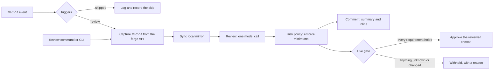

# How it works

## The pieces

ChangeHarbor talks to one **forge** per repository, GitHub or GitLab. It
reads the change's identity (head and target commits, project IDs), draft
state, labels, author and comment text from the API. Webhook payloads only
tell it which change to look at.

Source code comes from a local `git` **mirror**, read with hooks and
external diff tools disabled. With `mirror.sync: auto` ChangeHarbor clones
the mirror on first use and fetches the target branch and the change's head
before every review and approval check.

The **review** is one model call. Host code builds the prompt from your
trusted review instructions (`review.instructions`, plus the path
instructions for files that changed), the exact diff, related source and
your policy facts. Files matching `review.exclude` are left out and listed in
the summary. The model returns findings (optionally with a suggested fix),
a per-file walkthrough, open questions and `model_merge_risk`, from 1 (lowest
risk) to 10. It has no tools and can't ask for more. The reply is validated
against a schema, and a finding that names a line must point at a changed
line.

A change too large for the model's request budget isn't sent at all, unless
`review.large_changes: partial` is set, in which case as many whole files as
fit are reviewed and the rest are listed. A partial review is never
approved. The budget is derived from the [model config](../configuration/providers.md#how-big-a-change-fits).

The [risk policy](../configuration/policy.md) sets minimum risk scores from
facts the model can't change: touched paths, change size, author
familiarity. The effective risk is the higher of the model's score and the
policy's minimum, and a change is approvable only at or below your
threshold. A `high` or `critical` finding, or an open question, also
withholds.

Each review is saved with its provenance: commits, policy digest and config
identity. Before **publishing** a comment or an approval, ChangeHarbor
re-reads the live forge and withholds if anything moved, or, by default, if
the forge's own protections aren't in place. `publish.protections: advisory`
drops the protection requirement. Either way ChangeHarbor withdraws its own
approval as soon as the change or its target moves.

## What starts a review

[`reviewd serve`](../guides/service.md) reviews a change when it's opened,
reopened, gets new commits, is marked ready, or is retargeted. Edits to the
title, labels or description don't start one. Before reviewing, the service
checks [`review.auto`](../configuration/reference.md#review): drafts are
skipped by default, and you can skip bot authors, labels and title keywords.

Anyone with write access can ask for a review by commenting
`@<bot_username> review` (or `/changeharbor review` on GitHub). That skips
`triggers`, drafts included. `reviewd review --url` reviews a change by
hand.

## Modes

Each kind of write has its own switch in [`publish`](../configuration/reference.md#publish):

| Mode | Approvals | Comments and inline comments |
| --- | --- | --- |
| `off` | Nothing happens. | Nothing happens. |
| `shadow` (default) | `reviewd publish` runs every live check and reports *would approve* or *would withhold: reason*. Nothing is written. | `reviewd comment` prints what it would post. |
| `submit` / `post` | Approves the exact reviewed commit. | Creates or updates the summary comment and, with `publish.inline_comments: post`, one comment per finding on its changed line. |

In `shadow` the service reviews and saves results but writes nothing. Start
every repository there, then follow the [rollout checklist](../guides/rollout.md).

## Two files

`changeharbor.yaml` says what you want. It is reviewed and committed, and it
lives outside the repositories it reviews, so a pull request can't change
how it's reviewed.

`changeharbor.lock.yaml` holds the identities ChangeHarbor looked up for
you: project IDs, default branch, bot user and username, and the GitHub App
installation. `reviewd config resolve` writes it, and you commit it too. If
you change something the lock depends on, commands stop and ask you to
resolve again.
