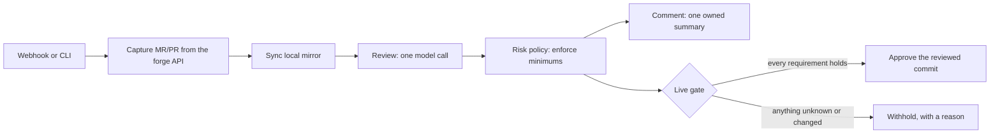

# How it works

## The pieces

**Forge.** GitHub or GitLab. ChangeHarbor reads the change's identity (head
and target commits, project IDs) from the API, never from webhook payloads.

**Mirror.** A local `git` mirror of the repository. Source code is read only
from here, with hooks and external diff tools disabled. ChangeHarbor can keep
it fresh itself (`mirror.sync`).

**Review.** Host code builds one prompt: the exact diff, related source and
your trusted policy facts. One model call returns findings, open questions
and `model_merge_risk` (1 = lowest risk, 10 = highest). The model has no
tools and can't ask for more.

**Risk policy.** A [JSON policy](../configuration/policy.md) sets minimum risk
scores from facts the model can't change: touched paths, change size, author
familiarity. The **effective risk** is the higher of the model's score and
the policy's minimum. It's approvable only at or below your threshold.

**Publication.** Each review is saved with its provenance: commits, policy
digest and config identity. Before commenting or approving, ChangeHarbor
re-reads the live forge and withholds if anything moved. Approval doesn't
depend on the forge's protection settings. Instead, ChangeHarbor withdraws its
own approval as soon as the change or its target moves.

## Modes

Each kind of write has its own switch in [`publish`](../configuration/reference.md#publish):

| Mode | Approvals | Comments |
| --- | --- | --- |
| `off` | Nothing happens. | Nothing happens. |
| `shadow` (default) | Every live check runs, and the result says *would approve* or *would withhold: reason*. Nothing is written. | The comment is rendered and printed. |
| `submit` / `post` | Approves the exact reviewed commit. | Creates or updates the summary comment. |

Start every repository in `shadow`, then turn writes on when the shadow results
look right.

## Two files

- **`changeharbor.yaml`**: what you want. Reviewed and committed.
- **`changeharbor.lock.yaml`**: identities ChangeHarbor looked up for you:
  project IDs, default branch and bot user. Written by
  `reviewd config resolve`, and committed too. If you change something the lock
  depends on, commands stop and ask you to resolve again.
